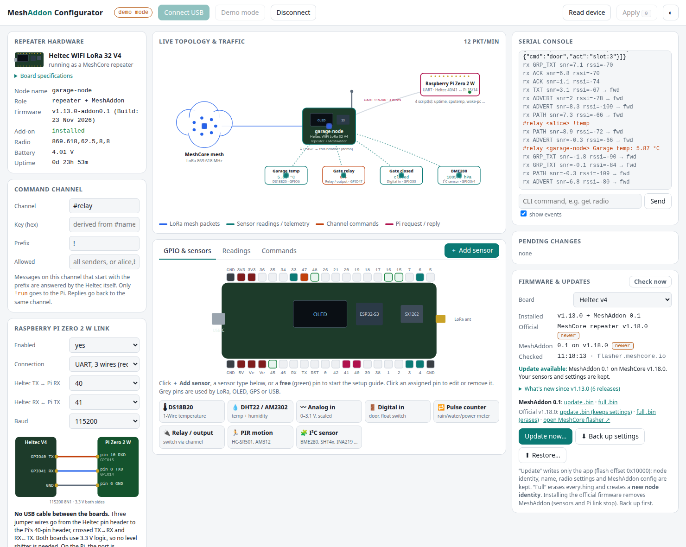
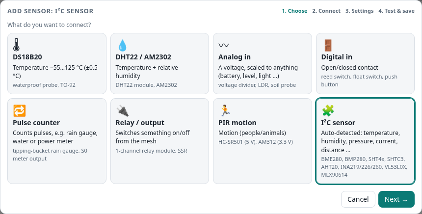
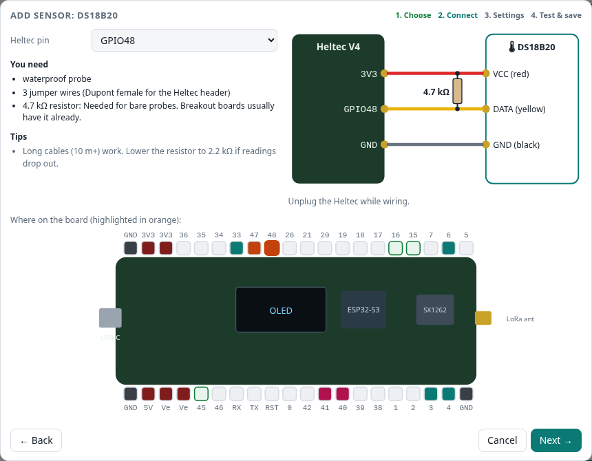
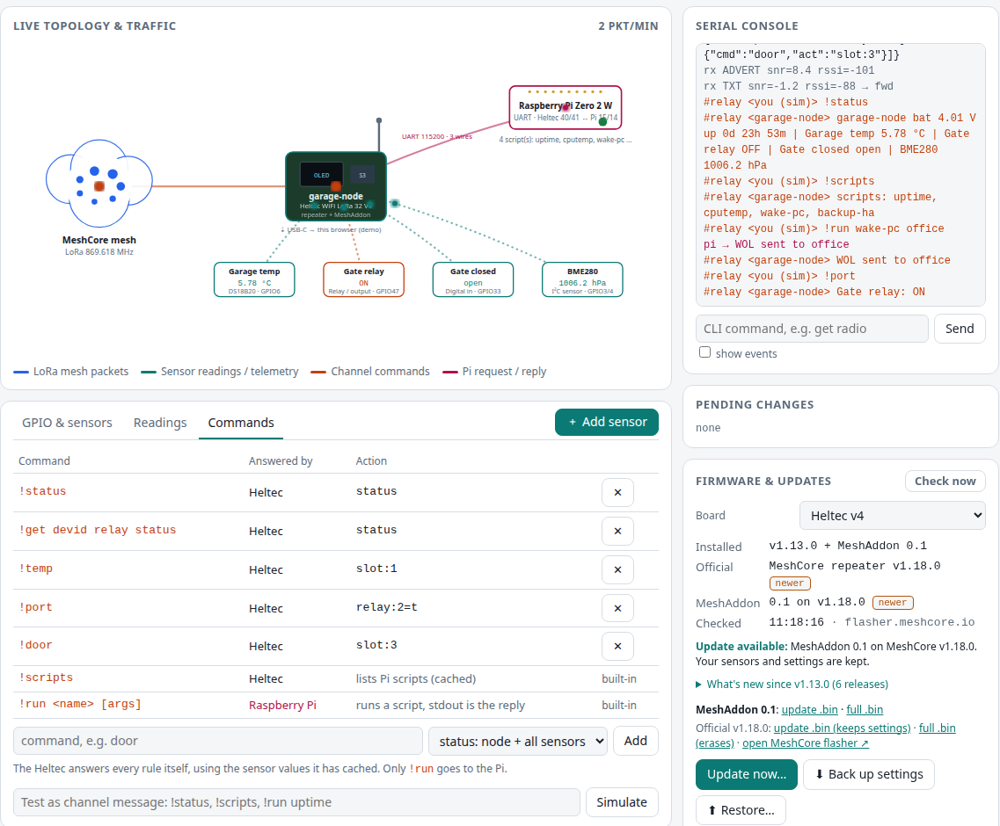
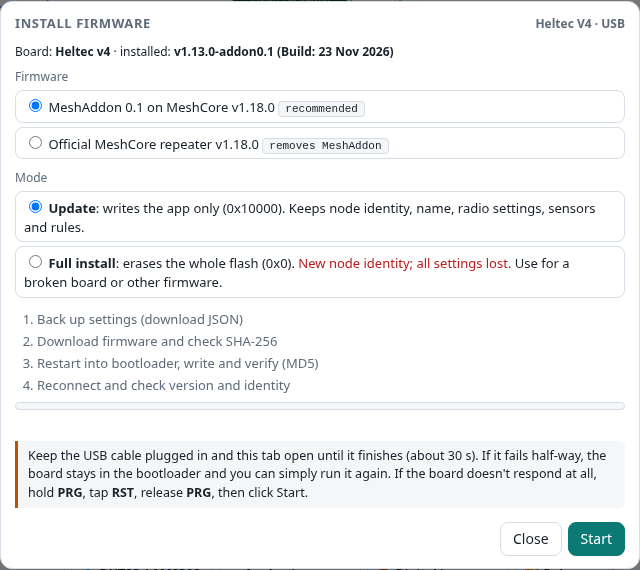
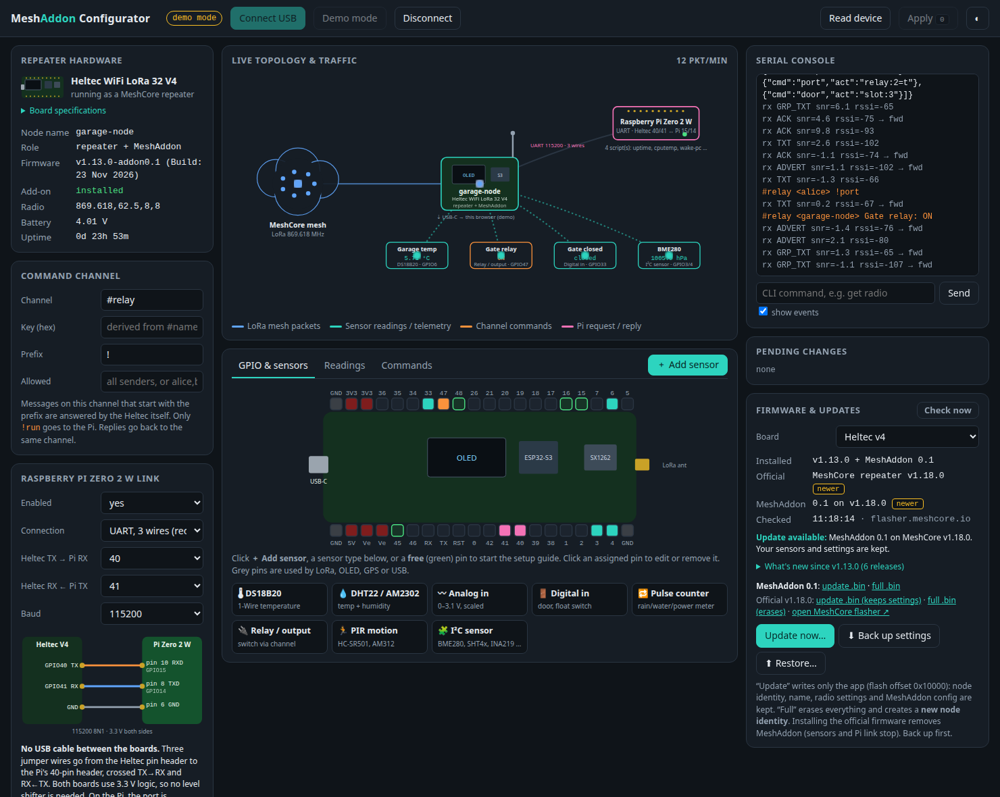

# MeshAddon

**Turn a Heltec V4 MeshCore repeater into a sensor and control node, configured from your browser.**

MeshAddon is a small add-on to the official [MeshCore](https://github.com/meshcore-dev/MeshCore) repeater firmware. It adds GPIO sensors, relays,
a command channel and an optional Raspberry Pi "script runner", plus a web configurator that talks to the board over USB (Web Serial).
The configurator shows live traffic and where things are wired, and it can install or update the firmware.

**▶ Try it now: [meshwiki.no/gpio-configurator](https://meshwiki.no/gpio-configurator/)** (Chrome or Edge; use **Demo mode** if you have no board at hand)

[](https://meshwiki.no/gpio-configurator/)

## What it does

- **Still a normal repeater.** It forwards everything exactly like the official MeshCore repeater; the add-on runs alongside it.
- **GPIO sensors in telemetry:** DS18B20, DHT22, analog (with scale/offset), door/float switches, pulse counters (rain gauge, water/S0 meters) and PIR. I²C sensors (BME280, SHT4x, AHT20, INA219/226/260, VL53L0X, MLX90614 …) are auto-detected using MeshCore's own drivers. Values are sent as CayenneLPP telemetry, so they appear in the MeshCore app and in Home Assistant's MeshCore integration.
- **Relays:** on/off/toggle or a timed pulse (garage-door button), controlled from the mesh.
- **Command channel:** the repeater decrypts *one* channel you choose (e.g. `#relay`) and answers commands itself:
  `!status` → `garage-node: bat 4.01V up 0d23h | Garage temp 5.8C | Gate relay OFF | Gate closed closed`
- **Raspberry Pi scripts (optional):** wire a Pi Zero 2 W to the Heltec with three jumper wires. Any executable in `/opt/meshaddon/scripts` can then be run from the mesh with `!run <name> [args]`, and its output is the reply. `!scripts` lists them.
- **Web configurator:**
  - animated topology and traffic view
  - clickable Heltec V4 pin header and an **Add sensor** wizard with wiring diagrams
  - command rules and a serial console
  - settings backup and restore
  - **firmware install and update in the browser** (esptool-js), with an update check against the official MeshCore flasher
- **Demo mode:** try the whole UI without any hardware.

| Add a sensor | Wiring guide |
|---|---|
|  |  |

| Command channel | Install / update firmware |
|---|---|
|  |  |

<details><summary>Dark mode</summary>


</details>

## How it fits together

```
            LoRa (MeshCore)                         USB (Web Serial)
 phone / ◀──────────────────▶  Heltec V4  ◀──────────────────────────▶  Browser: MeshAddon configurator
 nodes      #relay channel     repeater +                                (Chrome / Edge, HTTPS)
            "!status"          MeshAddon
                                │   │   └── GPIO: DS18B20, DHT22, analog, switches, counters, PIR, relays, I²C
                                │   └────── CayenneLPP telemetry → MeshCore app / Home Assistant
                                │ UART 3.3 V (GPIO47 TX / GPIO48 RX), JSON lines
                                ▼
                          Raspberry Pi Zero 2 W ── meshaddond: runs /opt/meshaddon/scripts/*
```

| Message on the channel | Answered by |
|---|---|
| `!status`, plus your own rules (`!temp`, `!gate` …) | Heltec, from cached sensor values |
| `!scripts` | Heltec, from the Pi's last script list |
| `!run <script> [args]` | Raspberry Pi, with the reply relayed by the Heltec |

Unknown commands get no reply. Replies are rate-limited to 1 every 5 s (EU868 duty cycle).

## Quick start

### 1. Open the configurator
The easiest way is the hosted copy at **https://meshwiki.no/gpio-configurator/**, so there's nothing to install. To run your own copy instead:

Web Serial needs **Chrome or Edge**, and the page has to be served over **HTTPS or localhost**.

```bash
git clone https://github.com/vinceneil666/meshaddon && cd meshaddon
MESHADDON_SITE=localhost:8444 docker compose up -d     # Caddy: HTTPS + flasher proxy + firmware files
# open https://localhost:8444  (Caddy's local CA, trust it once)
```
For a quick look without Docker, run `python3 -m http.server -d web 8000` and open http://localhost:8000. Demo mode, USB and the console work.
The **update check** needs the Caddy setup, which proxies `flasher.meshcore.io` (it sends no CORS headers) as `/mc/`.

**Apache + PHP hosting** (shared web hosting is fine, as long as it has HTTPS): `deploy/apache/` has a small allow-listed
PHP proxy (`mc.php`, replaces Caddy's `/mc/`) and an `.htaccess`. Deploy over SSH with
```bash
deploy/apache/deploy.sh user@host:path/to/webroot/gpio-configurator
```
If the site's root `.htaccess` sends everything to an app (WordPress, BookStack …), exclude the folder there:
`RewriteCond %{REQUEST_URI} !^/gpio-configurator(/|$)`.

### 2. Install MeshAddon
- Plug the Heltec V4 into the computer running the browser → **Connect USB** → **Install MeshAddon…** (or **Firmware & updates → Update now…**).
- **Update** writes only the app partition: the node keeps its identity, name, radio settings and passwords. **Full install** erases the flash and gives the node a new identity.
- Prebuilt binaries are on the [Releases](https://github.com/vinceneil666/meshaddon/releases) page. To install one manually:
  ```bash
  python3 -m esptool --chip esp32s3 -p /dev/ttyACM0 write_flash 0x10000 meshaddon-heltec_v4-v1.18.0-addon0.1.bin
  ```

### 3. Add sensors and commands
Use **＋ Add sensor**, then **Apply**. In the MeshCore app, add the hashtag channel `#relay` (or whatever channel you configured) and send `!status`.
Use a private channel with its own key for relays and scripts: anyone who knows a hashtag channel's name can send commands on it.

### 4. Optional: Raspberry Pi scripts
| Heltec V4 | Pi Zero 2 W |
|---|---|
| GPIO47 (TX) | pin 10 – GPIO15 / RXD |
| GPIO48 (RX) | pin 8 – GPIO14 / TXD |
| GND | pin 6 – GND |

Both sides are 3.3 V logic, so no level shifter is needed. Give the Pi its own 5 V supply. Then, on the Pi:
```bash
cd pi && ./install.sh          # enables the UART, installs meshaddond as a service
cp myscript.sh /opt/meshaddon/scripts/ && chmod +x /opt/meshaddon/scripts/myscript.sh
```
- **How scripts run:** as user `meshaddon`, without a shell, with sanitised arguments, a 30 s timeout and one instance per script.
- **Reply:** the script's stdout (max 140 characters) becomes the reply on the channel.
- **Description:** add `# desc: …` near the top of the script to show a description in the GUI.

## Security notes

- **Change the repeater's admin password.** MeshCore ships with `password`. Anyone in radio range who knows that can log in remotely and reconfigure the node. Over USB: `password <new>`.
- **Hashtag channels are public.** The key of `#relay` is derived from its name, so anyone can join it and send `!…` commands. Use a private channel with a random key for relays and Pi scripts.
- **The sender allow-list is not authentication.** The sender name in a channel message is chosen by the sender. Only the channel key protects your commands.
- **Pi scripts get untrusted arguments.** meshaddond never uses a shell and only allows `[A-Za-z0-9_.,:=@+/-]`, but a script must still treat `$1…` as hostile (e.g. `../`, or a leading `-` passed on to another command).
- **Hosting:** Web Serial permission, `localStorage` (the last backup, including the channel key) and cookies are shared by everything on the same origin. Host the configurator on its **own origin** (e.g. a subdomain), not next to a CMS or forum. `deploy/apache/htaccess` sets a strict CSP (hash-pinned inline script), `frame-ancestors 'none'` and `nosniff`.
- **Only restore backup files you made yourself.** Restore only applies known settings, but the values still go to the device.

## Hardware

**Heltec WiFi LoRa 32 V4:** ESP32-S3R2 (16 MB flash, 2 MB PSRAM), SX1262 with a PA front end, OLED, native USB-C. 3.3 V logic.

| Use | Pins |
|---|---|
| Free for sensors | 3, 4, 6, 15, 16, 33, 40, 41, 45, 47, 48 |
| Analog (ADC) | 3, 4, 6, 15, 16 |
| I²C (fixed) | SDA = 3, SCL = 4 (same as MeshCore's `heltec_v4_sensor` build) |
| Pi UART (default) | TX 47, RX 48 |

> Check the pins against your board's silkscreen before soldering. Pins 3 and 45 are strapping pins: fine for sensors, but don't pull them hard at boot.

## Firmware

```
firmware/addon/MeshAddon.{h,cpp}   the add-on (compiled only with -D MESHADDON=1)
firmware/meshaddon.patch           small hooks in examples/simple_repeater + PlatformIO env heltec_v4_repeater_addon
firmware/build-release.sh vX.Y.Z   official tag repeater-vX.Y.Z + add-on → fw/*.bin + fw/manifest.json
firmware/check-upstream.py         polls flasher.meshcore.io; builds MeshAddon when a new official repeater is released
firmware/test-flash.mjs            runs web/flash.js (the browser flashing code) from Node against a real board
```

Build it yourself (needs PlatformIO and a clone of MeshCore in `~/MeshCore`):
```bash
firmware/build-release.sh v1.18.0
```
The patch hooks into upstream extension points (`searchChannelsByHash` / `onGroupDataRecv`, the telemetry request,
`logRx`, the serial CLI), so it stays small and usually applies unchanged to new MeshCore releases.

All protocols (USB CLI `addon …`, event stream, Heltec↔Pi JSON, mesh side) are documented in [docs/PROTOCOL.md](docs/PROTOCOL.md).

## Status

v0.1 has been tested on a real Heltec V4:
- flashing, both the browser code path and esptool
- the node identity survives an update
- config persists across reboots
- relay and input events
- a `!status` reply over the air from the MeshCore phone app

Not yet tested on hardware: real DS18B20/DHT22/I²C sensors and the Pi link.
Only the Heltec V4 (OLED) is built so far; the V4 R8 and TFT variants are listed by the flasher but not built yet.

## Credits & license

- [MeshCore](https://github.com/meshcore-dev/MeshCore) (MIT): the firmware this extends. Firmware catalogue and releases come from the [official flasher](https://flasher.meshcore.io).
- [esptool-js](https://github.com/espressif/esptool-js) 0.7.1 (Apache-2.0), vendored in `web/vendor/`.
- MeshAddon itself: MIT, see [LICENSE](LICENSE).
